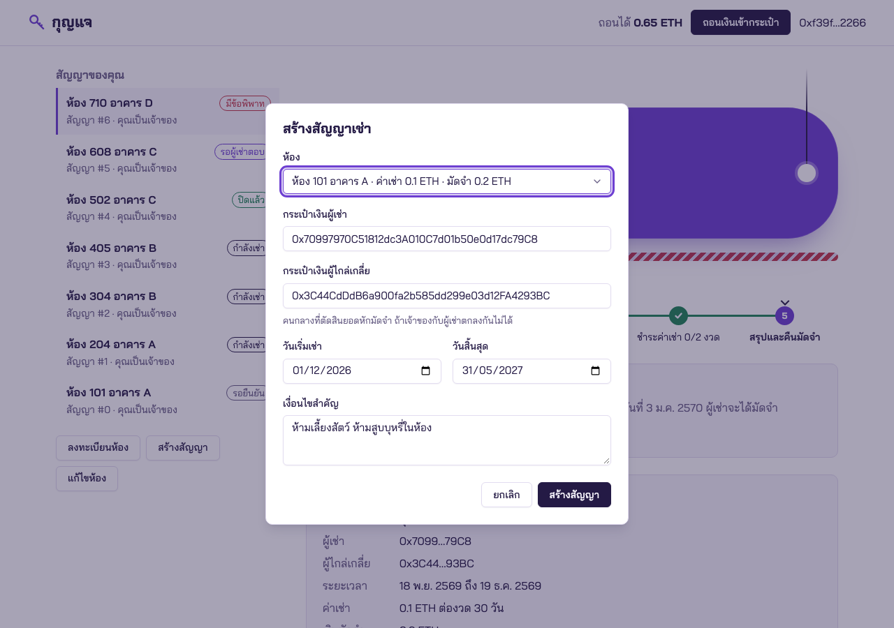
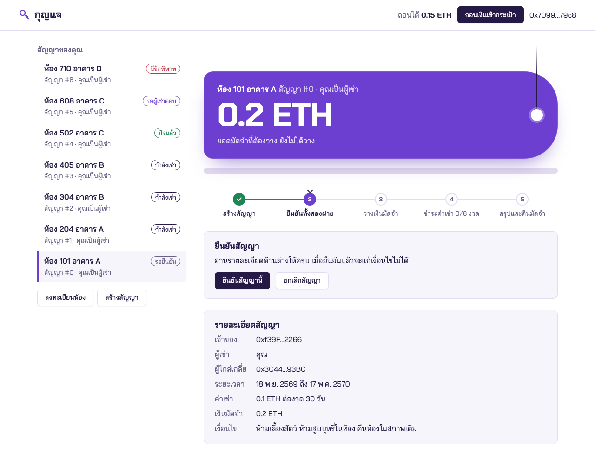
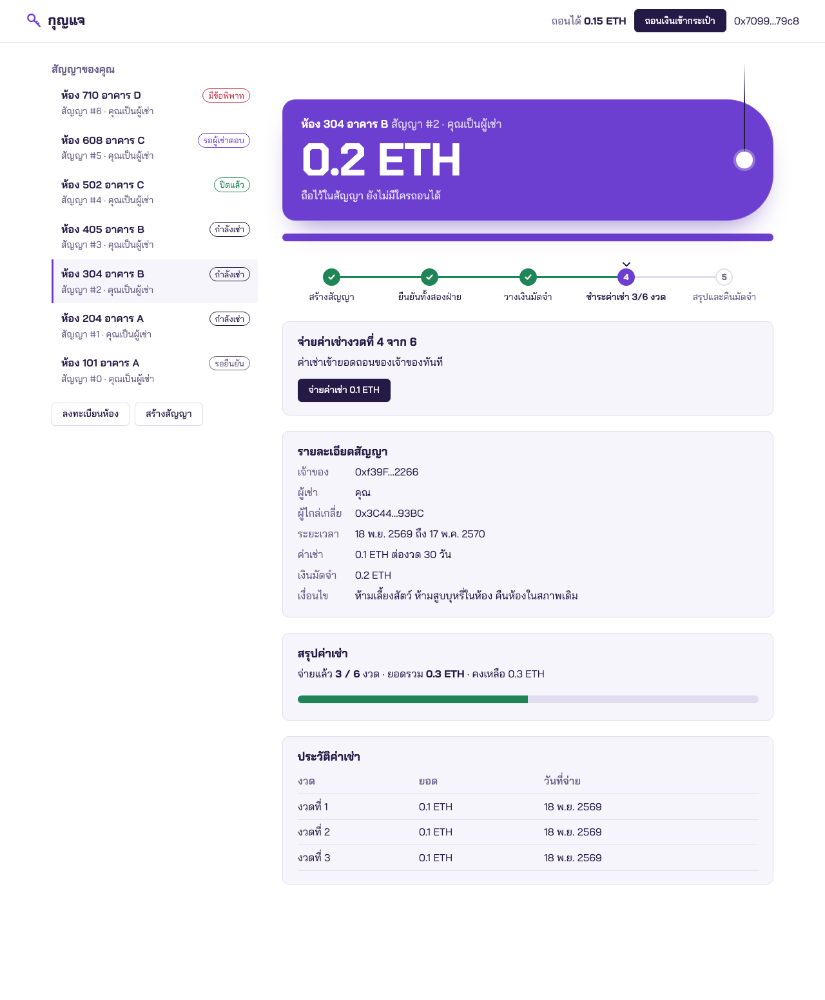
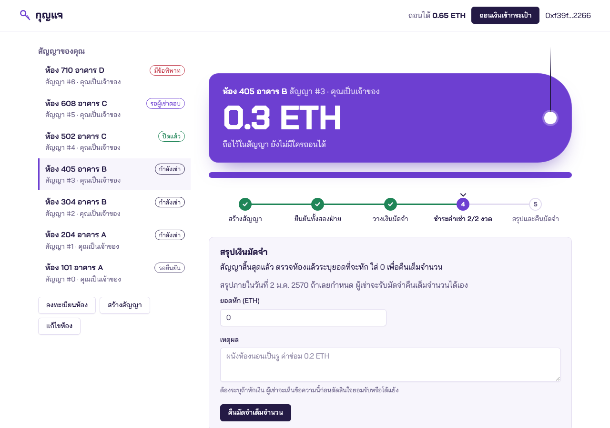
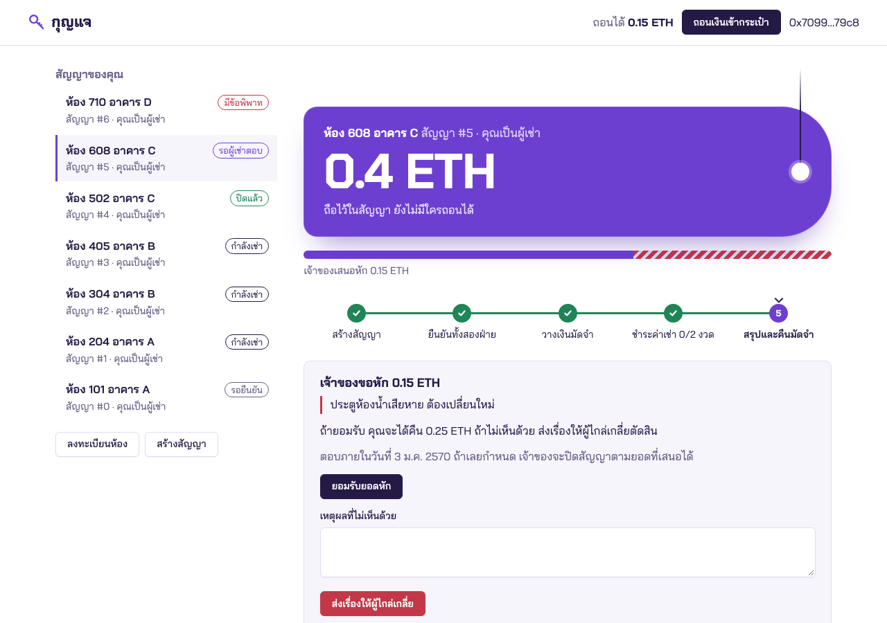
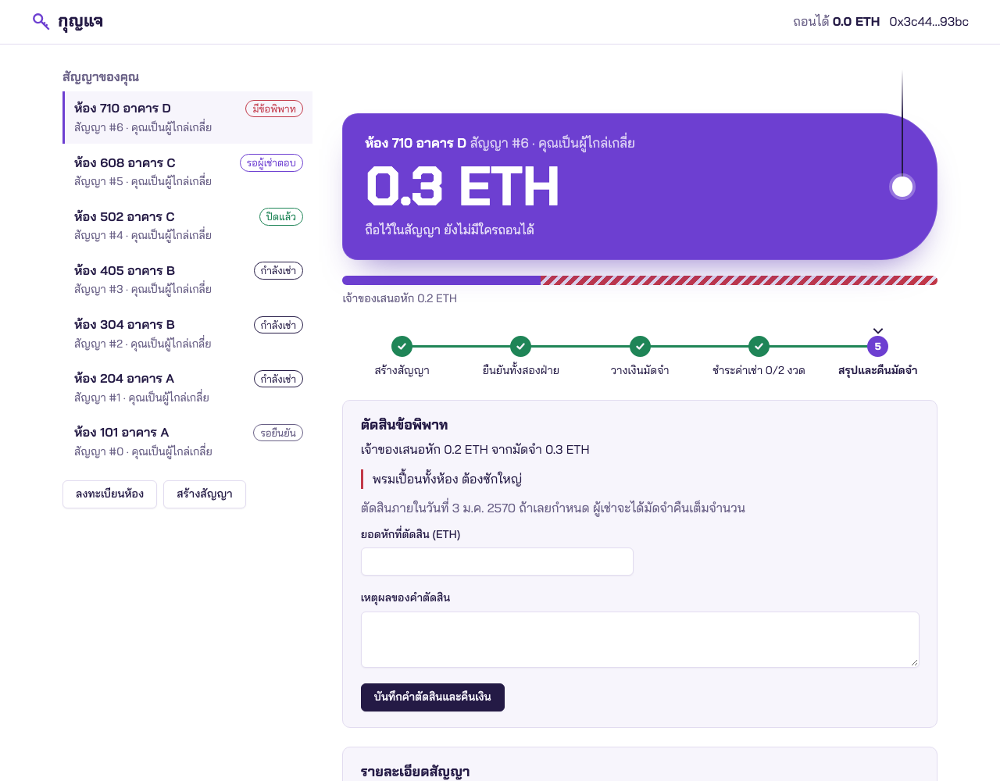

# ระบบจัดการสัญญาเช่าอสังหาริมทรัพย์และเงินประกัน

Smart Property Rental & Deposit Management: Smart Contract ที่ถือเงินประกันของผู้เช่าไว้ตามสถานะสัญญา ทั้งเจ้าของห้องและผู้เช่าถอนเงินเองไม่ได้จนกว่าจะตกลงกัน หรือผู้ไกล่เกลี่ยตัดสิน

- Smart Contract: [`contracts/RentalAgreement.sol`](contracts/RentalAgreement.sol)
- หน้าเว็บ: [`docs/index.html`](docs/index.html) (ใช้ ethers.js และ MetaMask)
- เครือข่าย: Sepolia `0xbBf2640C662aE3086f72EAf73702Ee87Cfc8F761` ([Etherscan](https://sepolia.etherscan.io/address/0xbBf2640C662aE3086f72EAf73702Ee87Cfc8F761))

## วิธีรัน

```bash
npm install
npm test              # รัน unit test
npx hardhat node      # เปิด blockchain จำลอง (ค้างไว้)
npm run deploy        # deploy ลง localhost และเขียน docs/contract.json
npm run ui            # เปิดหน้าเว็บที่ http://localhost:5173
```

## ฟังก์ชันตามโจทย์

| ข้อ | ความต้องการ | ฟังก์ชัน |
|---|---|---|
| 1 | ลงทะเบียนทรัพย์สิน | `registerProperty(name, rent, deposit)` |
| 2 | สร้างสัญญาเช่า | `createAgreement(propertyId, tenant, arbiter, start, end, terms)` |
| 3 | ยืนยันสัญญา | `confirmAgreement(id)` |
| 4 | ฝากเงินประกัน | `depositSecurity(id)` |
| 5 | บันทึกค่าเช่า | `payRent(id)`, `getPayments(id)` |
| 6 | คืนเงินประกัน | `proposeDeduction(id, amount, reason)`, `acceptDeduction(id)`, `withdraw()` |
| 7 | จัดการข้อโต้แย้ง | `disputeDeduction(id, reason)`, `resolveDispute(id, deduction, reason)` |

**กฎทางธุรกิจ:** การหักเงินประกันต้องมีเหตุผล (`reason required`) และหักเกินยอดคงเหลือไม่ได้ (`exceeds deposit`)

## ภาพหน้าจอ

### 1. ลงทะเบียนทรัพย์สิน
เจ้าของห้องกรอกชื่อห้อง ค่าเช่า และเงินประกัน


### 2. สร้างสัญญาเช่า
เจ้าของเลือกห้อง ระบุกระเป๋าเงินของผู้เช่าและผู้ไกล่เกลี่ย วันเริ่ม วันสิ้นสุด และเงื่อนไขสำคัญ



### 3. ยืนยันสัญญา
ผู้เช่ายืนยันด้วยกระเป๋าเงินของตัวเอง สัญญาจะเริ่มมีผลเมื่อยืนยันครบทั้งสองฝ่าย



### 4. ฝากเงินประกัน
ผู้เช่าโอน ETH เท่ากับยอดเงินประกันเข้า Smart Contract เจ้าของถอนเองไม่ได้


### 5. บันทึกค่าเช่า
ผู้เช่าจ่ายค่าเช่าทีละงวด และดูประวัติการจ่ายของแต่ละงวดได้



### 6. คืนเงินประกัน
เมื่อสัญญาสิ้นสุด เจ้าของตรวจห้องแล้วระบุยอดที่จะหัก ใส่ 0 เพื่อคืนเต็มจำนวน



ผู้เช่าเห็นยอดหักพร้อมเหตุผล แล้วเลือกยอมรับหรือส่งเรื่องให้ผู้ไกล่เกลี่ย



เมื่อยอมรับ ระบบแบ่งเงินตามยอดที่อนุมัติ (คืนผู้เช่า 0.15 ETH หักให้เจ้าของ 0.05 ETH)


### 7. จัดการข้อโต้แย้ง
ถ้าผู้เช่าไม่เห็นด้วย ผู้ไกล่เกลี่ยที่กำหนดไว้ในสัญญาจะเป็นผู้ตัดสินยอดหักและบันทึกเหตุผลก่อนปล่อยเงิน


